# UX review

Judged on a seeded gala: 8 lots, bids, a fund-a-need, and a paddle round. Phone at 390px, host at 1280px, room at 1920×1080 and 1280×720. Colours are the Thai.GER identity in [brand.md](brand.md), not the old navy and champagne.

References are the public Mobbin frames 01–20. Patterns were adapted. Other brands’ colours and logos were not copied.

## P0

**Thai on the bilingual room was too small to read from the back.** The English line was the size, and Thai is 70% of that line, so a 16px eyebrow made Thai 11px. Countdown and the Live badge were in the same trap.

Fixed. At 1080p the Thai under Live, the countdown, the paddle eyebrow, the goal and the pledge count is 33.3px, which is 70% of a 47.5px English line. The hero amount is the one big number. Pledge pills stay inside the stage (they end 27px above the bottom at 1080p).

At 720p the same Thai is 19.2px. That is the largest size that still keeps the pills on the stage. On the same physical screen a 720p pixel is about one and a half times a 1080p pixel, so the line is close to the same height in the room.

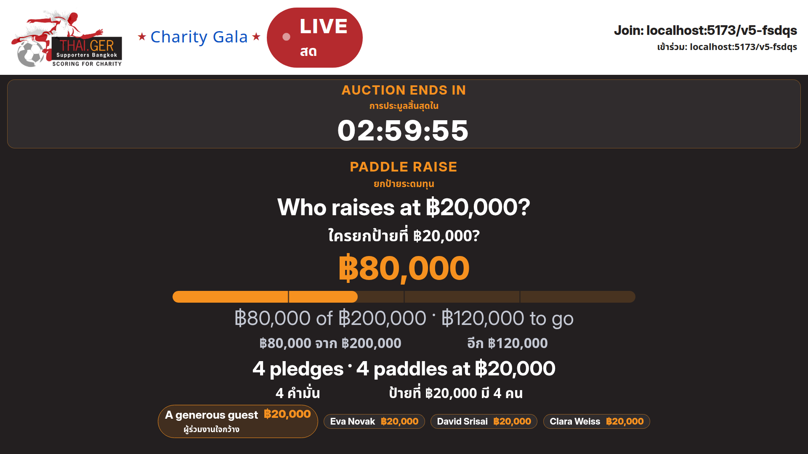

**The logo was a cramped thumbnail.** It is the original 1280×719 file, and the artwork touches the left edge, so a 40px (28px at 720p) slot cut into the clear space.

Fixed by layout only. The file bytes are unchanged (sha256 `a70f2e3d…03ce`, same as the file served by thaigersupporters.info). It sits on a `#ffffff` plate, which is the colour already in the file, with padding outside the image.

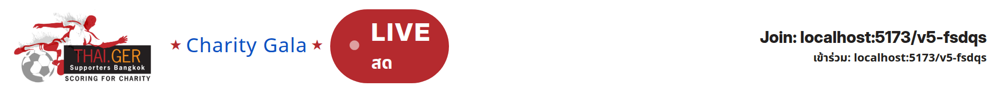

## P1

| Finding | What changed | Reference |
| --- | --- | --- |
| The room did not say who was up and how long was left in one glance, and the last minute stayed gold | Live badge, countdown, and the leader stay on screen. The last minute is `#b52a2e` on a white plate, because that red fails contrast on the ink. On the phone the last minute turns the timer into a red pill with white type | 05, 07 |
| The outbid alert could be read as “bid again now” | The alert says `Bid ฿5,500` and moves focus to that lot’s button. It does not place the bid | 04, 19 |
| The paddle and the fund had a bar and no sense of distance | 25/50/75 ticks, and “฿X to go”, on the room and on the need | 09, 10 |
| Donate amounts were a wrapping row | Two-column presets, 48px tall, plus a custom amount. A 3×2 grid does not fit a 390px phone with 48px targets | 11 |
| Top donors were a flat list | Initials, gold/silver/red marks for the top 3, and your row pinned with “You” | 12, 13 |
| Join did not say how payment works | “Nothing is charged now. … you pay afterwards by PromptPay QR.” No card on file | 17 |
| The invoice total and the pay action were apart | Bold total and a sticky `Pay ฿5,000` | 16, 18 |
| The host could not see the room | The event card has a live dot, the clock, and a preview of `/e/:code/engager` | 20 |

The bid card already had the centred amount, −/+, the leader, and a filled `Bid ฿…` button, so 01, 02 and 06 did not need a new sheet. The undo bar was already a solid dock (14).

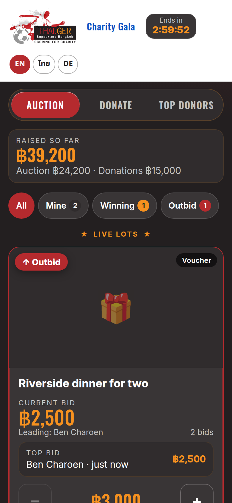

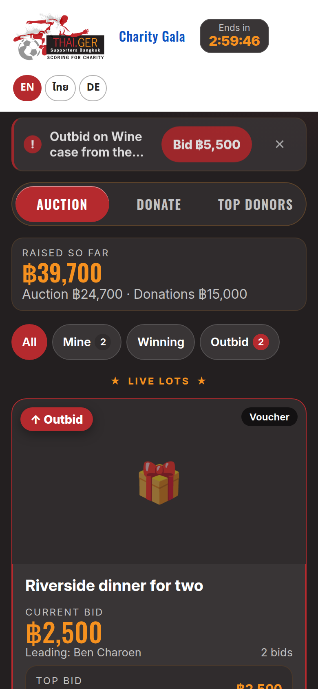

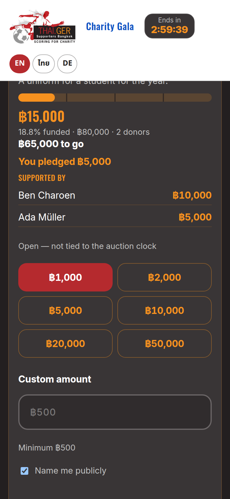

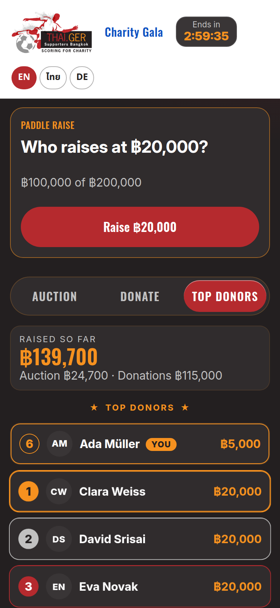

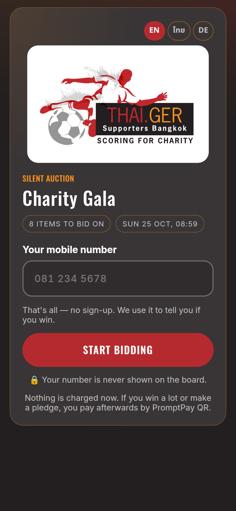

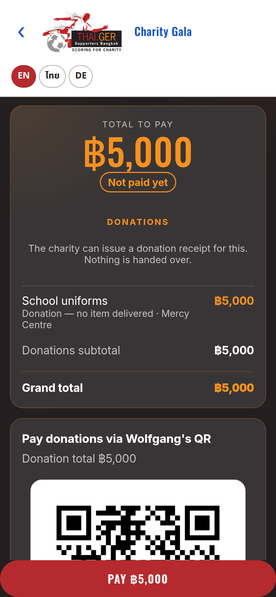

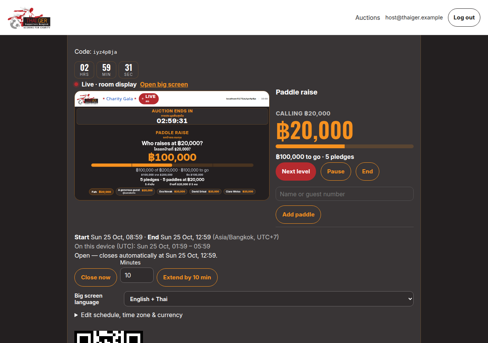

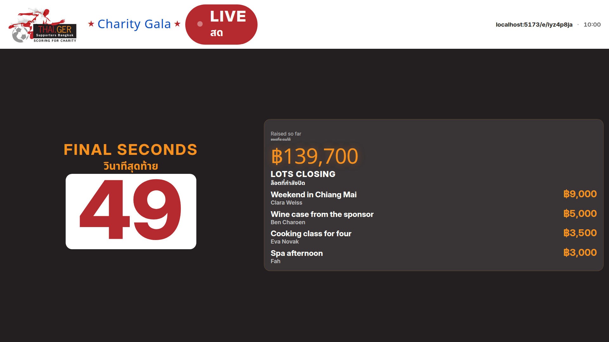

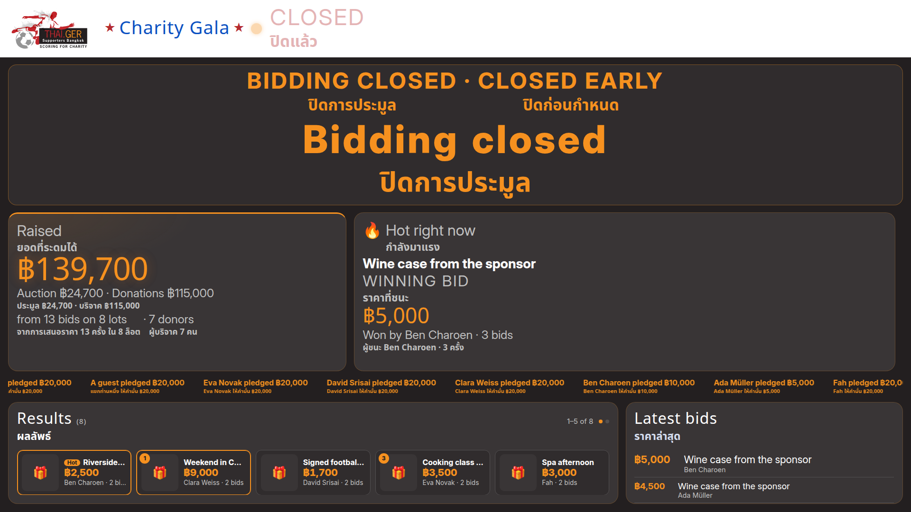

## P2

These follow the Mobbin notes in this review (frames 01–20). Patterns only — colours stay Thai.GER.

- Join code is six boxes (15): auto-advance, backspace, paste, numeric keyboard, 48px targets.
- Bid history (03) opens from the bid count. Older rows fade. Second place within one increment gets “So close” and a one-tap bid.
- Max bid (01) is its own sheet. The server bids the minimum up to that ceiling. An earlier maximum wins a tie. “Your max” sits on the card with edit and cancel.
- The live lot keeps a sticky Custom + Bid bar (06). The list pads clear of it, and the outbid banner stays in the flow above the cards.
- Watch (08) is a star on each lot, saved per guest, with a Watching filter and an outbid or closing-soon nudge.
- Paddle tiles (10) offer the called level and its neighbours. The host still moves the current level.
- A countdown ring (07) sits on every lot card all night. It stays quiet until the last five minutes, then turns red. Reduced motion drops the stroke transition.
- The host control room is its own render: status, next actions, and a small room preview on the host page’s one live connection. The room page is no longer framed in an iframe.

## Checked

No console errors on the seeded pass. Web typecheck, web tests and the web build were run on this branch. Thai at 1080p is 33.3px on headlines and 70% of every secondary English line (21.9px under a 31.3px label). The logo aspect on the guest header is 64px tall by 114px wide, which is 1280×719. On the projector the same file is 151px tall at 1080p (96px at 720p), about 85% of the white band, with clear space above and below. The right of that band reads “Join: host/code” at 31px (24px at 720p), Thai underneath. The screen is a 100vh grid. Tiles size to their text, and lists draw only whole rows. Raised so far is the label, the total and one tally line. On a closed night that tally sits under the total, and Top lot — the highest price a lot actually sold for, earliest on a tie — takes the full row, with the name on the left and Sold for plus the winner on the right. The QR has no URL under it. A closed night hides Latest bids and gives that width to Results. Results drop the live Hot and rank badges; a lot with no bids reads No bids. Closed early sits under the thank-you; at 1080p it is 25px (17px Thai). Live is a solid red dot and LIVE · สด under the title, with a red rule on the white band; closed is an ink dot, CLOSED · ปิดแล้ว, and an orange rule. The last minute is one centre timer, and the closed screen leads with thank-you and the total.
